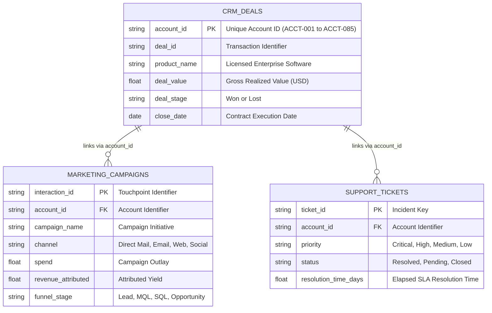

# NovaTech Enterprise CRM & Revenue Analytics with Amazon Quick Sight

[](https://aws.amazon.com/quick/quicksight/)
[](https://aws.amazon.com/quick/quicksight/)
[](https://aws.amazon.com/)

A comprehensive business intelligence platform and Generative BI evaluation using **Amazon Quick** and **Amazon Quick Sight**. The system integrates multi-domain telemetry across sales pipeline performance, marketing funnel conversions, and enterprise customer health records for NovaTech Corporation.

---

## Executive Summary

This repository encompasses the data architecture, schema specifications, validation logs, and executive presentation deliverables for NovaTech's enterprise analytics infrastructure.

By synthesizing relational data from sales, marketing, and support streams connected through `account_id`, this platform enables unified cross-departmental visibility and validates Amazon Quick's natural-language analytics against visual dashboard benchmarks.

---

## Relational Data Architecture



---

## Repository Structure

```text
novatech-crm-analytics/
├── data/                                 # Normalized tabular datasets
│   ├── novatech_crm_deals.csv            # Closed sales opportunities & deal stages
│   ├── novatech_marketing_campaigns.csv  # Multi-channel touchpoints & spend telemetry
│   └── novatech_support_tickets.csv      # Customer incident & SLA resolution records
├── docs/                                 # Enterprise specifications & audit logs
│   ├── data_verification_log.md          # Pre-ingestion schema & row count audit
│   ├── quicksight_q_exploration_log.md   # Generative BI validation & accuracy matrix
│   ├── novatech_company_background.pdf   # Corporate domain profile & operations
│   ├── novatech_data_dictionary.md       # Comprehensive feature dictionary & data types
│   └── sarah_chen_dashboard_brief.pdf    # Executive stakeholder requirements brief
├── reports/                              # Executive deliverables
│   └── novatech_executive_report.pdf     # C-suite analytical synthesis & recommendations
├── screenshots/                          # Audit & dashboard telemetry captures
│   ├── data_import/                      # Ingestion workflow captures
│   ├── data_transformation/              # Calculated fields & schema joins
│   └── topic_exploration/                # Amazon Quick natural-language queries
├── .gitignore                            # Environment & OS ignore rules
└── README.md                             # Master repository documentation
```

---

## Dataset Portfolio

| Dataset                                        | Primary Scope                                             |    Volume    | Key Dimension          |
| :--------------------------------------------- | :-------------------------------------------------------- | :-----------: | :--------------------- |
| **`novatech_crm_deals.csv`**           | Closed pipeline opportunities, won/lost ratios, deal size |   499 rows   | 85 Enterprise Accounts |
| **`novatech_marketing_campaigns.csv`** | Funnel progression, CAC, channel efficacy, marketing ROI  |  2,240 rows  | 4 Channel Types        |
| **`novatech_support_tickets.csv`**     | SLA response times, ticket urgency, churn risk indicators | 3,000 records | Critical vs. Low Tiers |

> **Relational Integrity Note:** `account_id` serves as the primary entity identifier. An intentional, controlled subset of marketing and support records reference non-CRM accounts (`ACCT-101` through `ACCT-115`), representing top-of-funnel inbound leads and legacy support requests.

---

## Key Executive Insights

* **Channel Efficacy:** Direct Mail generated the highest conversion rate at **53.0%**, significantly outperforming broad digital awareness channels.
* **Account Tiers:** Enterprise-tier clients commanded the highest average deal value at **$1,589.17**, requiring dedicated account-management coverage.
* **SLA Performance:** Critical-priority incidents achieved an average resolution time of **1.79 days**, compared with 1.97 days for low-priority tickets.
* **Customer Retention:** The top 10 accounts by support volume accounted for **106,842 tickets** and **~$169.7M** in cumulative annual contract value, highlighting critical accounts requiring proactive technical account management (TAM).
* **Marketing Capital Allocation:** All campaign initiatives maintained positive return on investment; **NovaPulse Launch** led with peak return efficiency (**962.7x**), while **NovaEdge Awareness** served primarily brand-building functions (**124.6x**).

---

## Generative BI & Amazon Quick Evaluation

This implementation benchmarked natural-language generative queries against visual dashboard telemetry:

1. **Accuracy Parity:** Across all test scenarios, Amazon Quick's natural-language analytics achieved **100% concordance** with dashboard visual ground truth.
2. **Operational Integration:** Amazon Quick is recommended for self-service executive inquiries, while operational dashboards maintain regulatory data lineage.

For the complete validation matrix, refer to [`docs/quicksight_q_exploration_log.md`](docs/quicksight_q_exploration_log.md).

## Project Status

This repository contains the source datasets, reference materials, templates, and documented Amazon Quick validation work for the NovaTech analytics project. It represents a hands-on portfolio project from the Udacity AI/ML Scholars and AWS Future Business Professional learning journey.